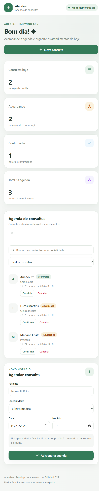
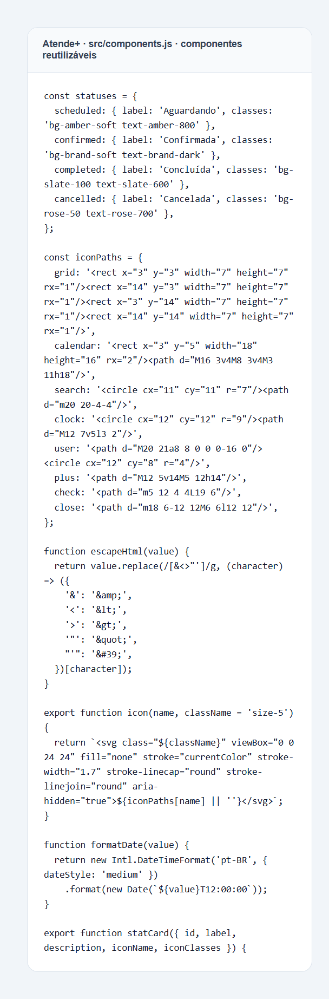

# Atividade 02 — Tailwind CSS

Aplicação responsiva de agenda acadêmica Atende+, desenvolvida com HTML, JavaScript, Vite e Tailwind CSS. Os registros são fictícios e ficam armazenados localmente no navegador.

## Executar localmente

Requisitos: Node.js `>=22.12.0`.

```bash
npm ci
npm run dev
```

Para validar a versão de produção:

```bash
npm run build
npm run preview
```

## Funcionalidades

- Cadastro de consultas com validação dos campos.
- Busca por paciente ou especialidade e filtro por status.
- Confirmação, conclusão e cancelamento de consultas.
- Indicadores que acompanham os registros e os filtros selecionados.
- Persistência no `localStorage` do navegador.
- Layout responsivo e suporte à preferência por movimento reduzido.

## Evidências

### Aplicação em viewport móvel



### Código dos componentes



## Classes utilitárias Tailwind utilizadas

A tabela documenta classes distintas presentes no HTML e nos componentes JavaScript do projeto. Prefixos de estado e breakpoint são mantidos como aparecem no código.

| Categoria | Classe | Aplicação |
|---|---|---|
| Cores | `bg-brand` | Fundo da cor principal da identidade visual. |
| Cores | `bg-brand-soft` | Fundo suave para estados e ações relacionadas à marca. |
| Cores | `bg-page` | Fundo de áreas secundárias da interface. |
| Cores | `bg-white` | Fundo de cartões e painéis. |
| Cores | `text-brand` | Texto ou ícone na cor principal. |
| Cores | `text-brand-dark` | Texto de ação com contraste reforçado. |
| Cores | `text-ink` | Texto principal de títulos e valores. |
| Cores | `text-muted` | Texto auxiliar e descrições. |
| Cores | `text-rose-700` | Texto de ações destrutivas. |
| Tipografia | `font-sans` | Família tipográfica padrão da interface. |
| Tipografia | `text-xs` | Rótulos e informações compactas. |
| Tipografia | `text-sm` | Conteúdo secundário e controles. |
| Tipografia | `text-lg` | Títulos de seção. |
| Tipografia | `text-3xl` | Valores em destaque nos indicadores. |
| Tipografia | `font-medium` | Ênfase intermediária em rótulos. |
| Tipografia | `font-semibold` | Ênfase de botões e títulos de cartões. |
| Tipografia | `font-bold` | Destaque de valores e identificadores. |
| Tipografia | `tracking-tight` | Ajuste do espaçamento de títulos e números. |
| Tipografia | `leading-5` | Controle da altura de linha em textos auxiliares. |
| Espaçamento | `p-5` | Espaço interno de cartões. |
| Espaçamento | `px-4` | Espaçamento horizontal de campos e botões. |
| Espaçamento | `py-4` | Espaçamento vertical da lista de consultas. |
| Espaçamento | `mt-5` | Separação entre rótulo e valor do indicador. |
| Espaçamento | `mb-8` | Distância após blocos de conteúdo. |
| Espaçamento | `gap-3` | Espaço entre elementos em grupos flexíveis. |
| Espaçamento | `space-y-4` | Separação vertical entre campos do formulário. |
| Dimensões | `w-full` | Ocupa a largura disponível. |
| Dimensões | `max-w-7xl` | Limita a largura máxima do conteúdo. |
| Dimensões | `min-h-screen` | Mantém a estrutura com altura mínima da tela. |
| Dimensões | `size-10` | Define largura e altura iguais para ícones. |
| Dimensões | `min-w-0` | Permite que conteúdo flexível encolha sem overflow. |
| Bordas | `border` | Adiciona contorno aos cartões e controles. |
| Bordas | `border-line` | Aplica a cor de contorno do tema. |
| Bordas | `rounded-lg` | Arredonda controles compactos. |
| Bordas | `rounded-xl` | Arredonda ícones e elementos de formulário. |
| Bordas | `rounded-2xl` | Arredonda cartões e painéis. |
| Layout | `flex` | Organiza elementos em uma linha flexível. |
| Layout | `flex-col` | Empilha elementos verticalmente. |
| Layout | `grid` | Organiza indicadores e elementos em grade. |
| Layout | `grid-cols-1` | Exibe uma coluna em telas menores. |
| Layout | `items-center` | Alinha itens pelo centro do eixo transversal. |
| Layout | `justify-between` | Distribui itens nas extremidades do contêiner. |
| Layout | `shadow-panel` | Aplica a sombra de cartão definida no tema. |
| Interação | `focus:ring-4` | Destaca o controle que recebeu foco. |
| Interação | `hover:bg-brand-soft` | Indica visualmente o estado hover. |
| Interação | `transition` | Suaviza mudanças visuais de estado. |
| Responsividade | `sm:flex-row` | Coloca ações lado a lado a partir do breakpoint `sm`. |
| Responsividade | `sm:items-center` | Ajusta o alinhamento vertical a partir de `sm`. |
| Responsividade | `md:hidden` | Oculta elementos em telas médias ou maiores. |
| Responsividade | `lg:px-10` | Amplia o espaçamento horizontal em telas grandes. |
| Responsividade | `xl:grid-cols-4` | Exibe quatro colunas no breakpoint `xl`. |

## Links para publicação manual

- [ ] Repositório GitHub: inserir link após criar/publicar o repositório.
- [ ] Aplicação publicada: inserir link após realizar o deploy.

## Observações

Os dados de demonstração são fictícios. A persistência usa o armazenamento do próprio navegador; não há API, backend ou sincronização entre dispositivos.
